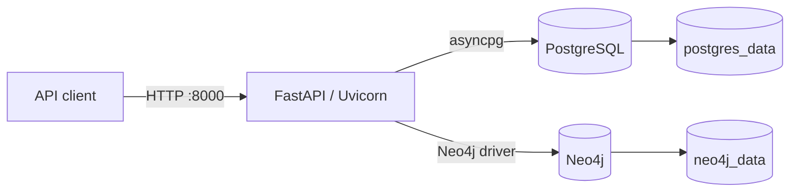
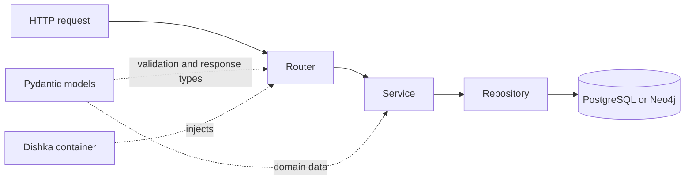
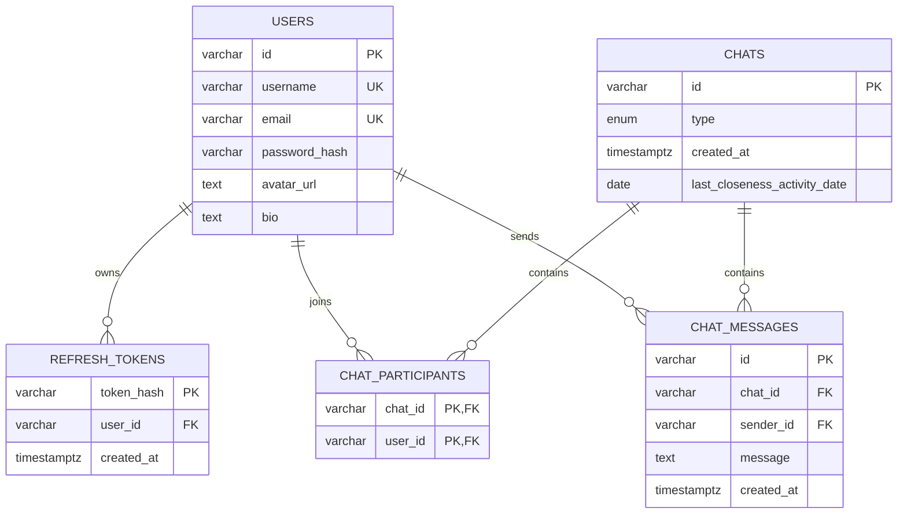
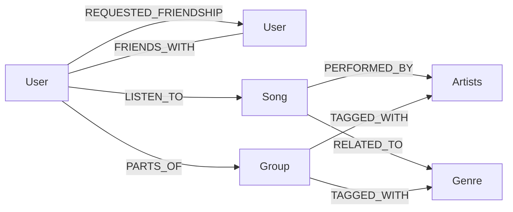

# ErasMusic architecture

ErasMusic is an asynchronous FastAPI application backed by PostgreSQL and
Neo4j. PostgreSQL stores transactional application data; Neo4j stores the
social and music graph used for discovery and recommendations.

## System overview

| Component | Responsibility |
|---|---|
| FastAPI | HTTP routing, validation, authentication and OpenAPI documentation |
| PostgreSQL | Users, refresh tokens, chats, participants and messages |
| Neo4j | Friendships, groups, music preferences and recommendations |
| Dishka | Creates application-scoped database connections and request-scoped services/repositories |
| Docker Compose | Runs the API and databases, applies schemas and optionally loads sample data |

## Docker architecture

The Compose stack contains these services:

| Service | Lifecycle |
|---|---|
| `postgres` | Persistent PostgreSQL 16 instance; applies `scripts/psql-init/` when its volume is first created |
| `neo4j` | Persistent Neo4j instance with HTTP and Bolt interfaces |
| `neo4j-init` | One-shot service that waits for Neo4j and applies uniqueness constraints |
| `api` | Builds the Python image and starts Uvicorn after PostgreSQL is healthy and Neo4j initialization succeeds |
| `postgres-seed`, `neo4j-seed` | Optional one-shot services enabled by the `seed` profile |

Database files are stored in named volumes. The API source and tests are bind
mounted for development, and Uvicorn runs with automatic reload. Database and
secret values are provided through environment variables.

## API layers

| Layer | Location | Responsibility |
|---|---|---|
| Model | `app/models/` | Pydantic request, response and internal data structures |
| Repository | `app/repositories/` | SQL and Cypher queries, with database results converted into models |
| Service | `app/services/` | Business rules, authorization decisions, pagination and transaction orchestration |
| Router | `app/routers/` | Paths, HTTP methods, query parameters, authentication dependencies and status codes |

Routers do not query databases directly. Dishka injects request-scoped services
and repositories. The PostgreSQL pool and Neo4j driver are application-scoped
and are opened and closed with the FastAPI application.

Some operations span both databases. Registration creates a PostgreSQL user and
its Neo4j `User`; group operations synchronize a Neo4j membership with the
linked PostgreSQL chat; qualifying chat activity updates Neo4j closeness. These
workflows keep the PostgreSQL transaction open until the Neo4j operation
succeeds. There is no distributed transaction coordinator, so PostgreSQL and
Neo4j remain separate consistency boundaries.

## PostgreSQL schema

- `chats.type` is either `direct` or `group`.
- `last_closeness_activity_date` prevents more than one closeness increase per
  direct chat and UTC day.
- Triggers enforce at most two direct-chat participants, require message
  senders to be participants, and remove invalid chats after membership removal.
- Foreign keys cascade chat, participant and token cleanup where appropriate.

## Neo4j schema

| Element | Important properties |
|---|---|
| `User` | `psqlId`, `username` |
| `Group` | `id`, `psqlChatId`, `ownerId`, `name`, `description` |
| `Song` | `id`, `title`, `coverURL`, `spotifyURL` |
| `Artists` | `id`, `name`, `profilePicture`, `spotifyURL` |
| `Genre` | `id`, `name` |
| `FRIENDS_WITH` | `closeness`, `closenessUpdatedAt` |
| `REQUESTED_FRIENDSHIP` | `requestId`, `pairKey`, `status`, `createdAt` |
| `LISTEN_TO` | `shortTermScore`, `mediumTermScore`, `longTermScore` |
| `PARTS_OF` | `role`, `joinedAt` |

`User.psqlId` references the logical PostgreSQL user, while
`Group.psqlChatId` identifies the group's PostgreSQL chat. Neo4j constraints
make these identifiers, entity IDs and friendship-request identifiers unique.
