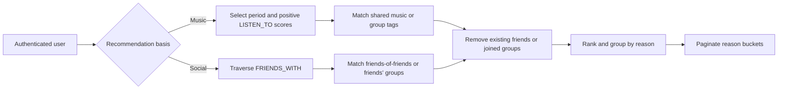
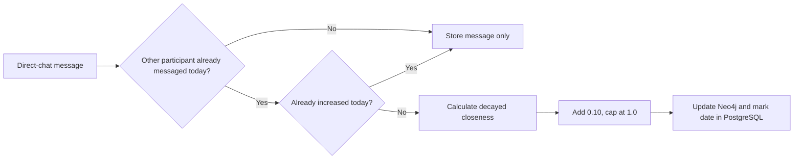

# ErasMusic functional documentation

ErasMusic lets users discover people and groups through music preferences and
social connections. This document describes behavior and business rules; exact
request and response schemas come from FastAPI at `/docs`, `/redoc`, and
`/openapi.json`.

## General API behavior

Registration and login return a short-lived access token and set a refresh
token. Protected routes identify the current user from the access token. The
stored refresh-token hash allows refresh and logout without storing the raw
token in PostgreSQL.

| Area | Behavior |
|---|---|
| Users | Read, update and delete profiles; user identity is shared between PostgreSQL and Neo4j |
| Friends | Send, list, accept or decline requests; inspect status; list or remove friends |
| Groups | Create and manage groups, members and artist/genre tags; each group owns a PostgreSQL group chat |
| Chats | Create direct or standalone group chats, manage participants and exchange messages |
| Search | Find users and groups |
| Music | Read artists, songs and genres stored in Neo4j |
| Recommendations | Discover non-friends and unjoined groups by music or social paths |

Direct chats require an existing friendship and are unique for a user pair.
Only participants can read a chat or send messages. Membership of a group-owned
chat is managed through the group API so that PostgreSQL and Neo4j stay aligned.

List endpoints return pagination metadata. Validation and business failures use
standard HTTP responses: `401` for invalid authentication, `403` for forbidden
actions, `404` for missing resources, `409` for state conflicts and `422` for
invalid input.

## Recommendation system

All recommendation routes require authentication. Results explain *why* an
item was recommended by grouping candidates under an artist, song, friend or
genre.

| Route | Result grouping and ranking |
|---|---|
| `GET /recommendations/friends/by-artists` | Artists by the user's affinity; candidates under each artist by their affinity |
| `GET /recommendations/friends/by-songs` | Songs by the user's score; candidates under each song by their score |
| `GET /recommendations/friends/by-friends` | Direct friends by effective closeness; their friends by the product of both path closeness values |
| `GET /recommendations/groups/by-artists` | Artist tags by the user's affinity; matching groups under each artist |
| `GET /recommendations/groups/by-genres` | Genre tags by the user's affinity; matching groups under each genre |
| `GET /recommendations/groups/by-friends` | Direct friends by effective closeness; unjoined groups containing each friend |

### Music periods and affinity

Music-based routes require a `period` query parameter. It selects one property
from each `LISTEN_TO` relationship:

| Period | Neo4j score |
|---|---|
| `short_term` | `shortTermScore` |
| `medium_term` | `mediumTermScore` |
| `long_term` | `longTermScore` |

Only positive scores participate. Artist and genre affinity is the sum of the
selected scores for the user's matching songs. This makes strongly represented
artists or genres appear before weaker ones for the selected period.

### Candidate rules

Friend recommendations exclude:

- the authenticated user;
- existing friends;
- music candidates with no positive score for the selected period.

Group recommendations exclude groups the user has already joined. Music-based
group recommendations require a matching artist or genre tag. Social group
recommendations require one of the user's direct friends to be a member.

### Grouping and pagination

Pagination applies to the outer explanation buckets. For example, the artist
route paginates artists, not all users inside those artists. Each returned
bucket contains at most 20 users or groups. A candidate can appear in more than
one bucket when several reasons apply; friend-based group results similarly
remain grouped under every applicable friend.



## Closeness system

Closeness represents recent mutual interaction between two friends. It is
stored on their `FRIENDS_WITH` relationship as:

- `closeness`: the value at the last update, from `0.0` to `1.0`;
- `closenessUpdatedAt`: when that stored value was calculated.

A new friendship starts at `0.0`. The value decays lazily with a 30-day
half-life: reads calculate the current value without writing it back.

```text
elapsedHalfLives = max(0, secondsSinceUpdate / 2,592,000)
effectiveCloseness = storedCloseness × 2 ^ (-elapsedHalfLives)
```

Consequently, inactivity reduces closeness to half after 30 days, one quarter
after 60 days, and so on. Future timestamps are treated as zero elapsed time.

### Direct-chat activity

A closeness increase occurs when both participants of a direct chat have sent a
message on the same UTC day:

1. The chat is locked in PostgreSQL to serialize concurrent messages.
2. The API verifies that the sender is a participant and that the other user
   has already messaged that day.
3. The message is inserted.
4. The previous closeness is decayed to the message time, then `0.10` is added,
   capped at `1.0`.
5. Neo4j stores the new value and timestamp.
6. PostgreSQL records the UTC date in `last_closeness_activity_date`.

This can happen at most once per direct chat per UTC day. One-sided activity
does not increase closeness, and group-chat messages never affect it.



### Effect on recommendations

Friend-of-friend recommendations score each two-edge path as:

```text
effectiveCloseness(user, friend)
× effectiveCloseness(friend, candidate)
```

Direct friends with higher effective closeness are shown first, and candidates
within each friend's bucket are ordered by the path product. Group-by-friend
recommendations also order the friend buckets by effective closeness. Because
decay is evaluated at query time, rankings can change after inactivity without
a background job.
